# Ein Kanban-Board auf GitHub einrichten

*Deutsche Version von `02_kanban_board.md`.*

Nutzt ein Projekt-Board auf GitHub, um eure Arbeit zu planen und die Meilensteine aus [01_assignment_DE.md](01_assignment_DE.md) zu verfolgen. Richtet es zu Beginn des Projekts gemeinsam als Team ein.

Die Einrichtung hat sechs Etappen: Repository erstellen, Board erstellen, dem Team Zugriff geben, Aufgaben hinzufügen, Meilensteine einrichten, dann beides verbinden. Arbeitet sie der Reihe nach ab.

## 1. Das Projekt-Repository erstellen

1. Klickt auf „Use this template“ (der blaue Knopf).
   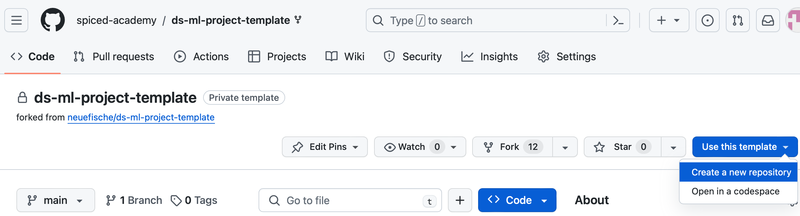

2. Erstellt ein neues Repository mit einem passenden Namen. Besitzer (**Owner**) sollte euer eigenes Konto sein.
   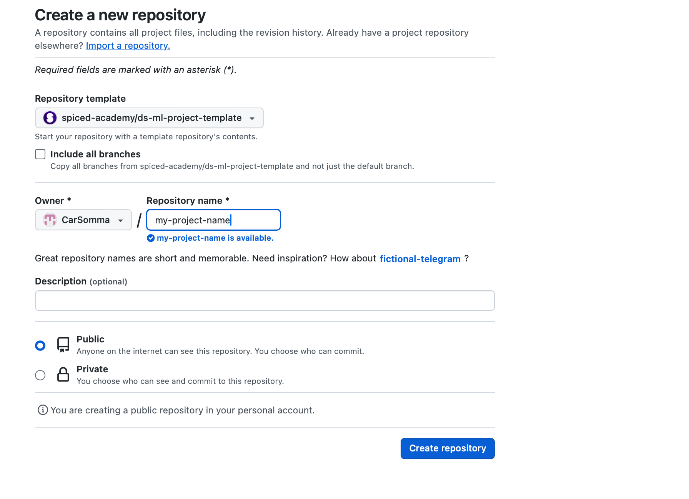

## 2. Das Kanban-Board erstellen

1. Geht in eurem neuen Repository zu „Projects“ und klickt auf „Link a project“ (der blaue Knopf). Wenn ihr noch kein Projekt angelegt habt, nutzt den Pfeil daneben, um eins in eurem Profil zu erstellen. Ihr könnt dieses Projekt am Ende mit eurem Repository verknüpfen.
   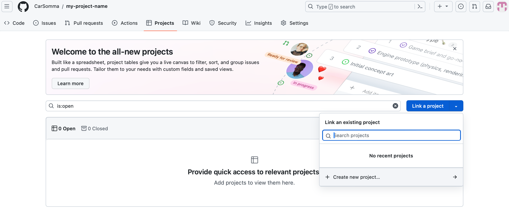

2. Ihr landet bei den Projekten eures Profils und seht ein Fenster „Create project“ (Projekt erstellen). Wählt die Ansicht **„Board“**, nicht „Table“.
   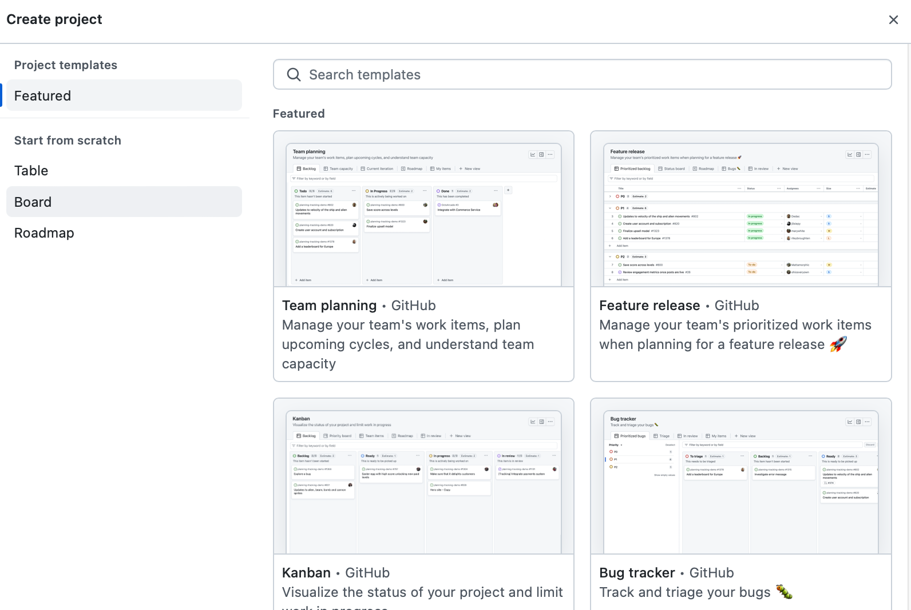

3. Ändert den Namen eures Boards passend zu eurem ML-Projekt und klickt dann auf den blauen Knopf „Create project“. Damit habt ihr ein Kanban-Board erstellt.
   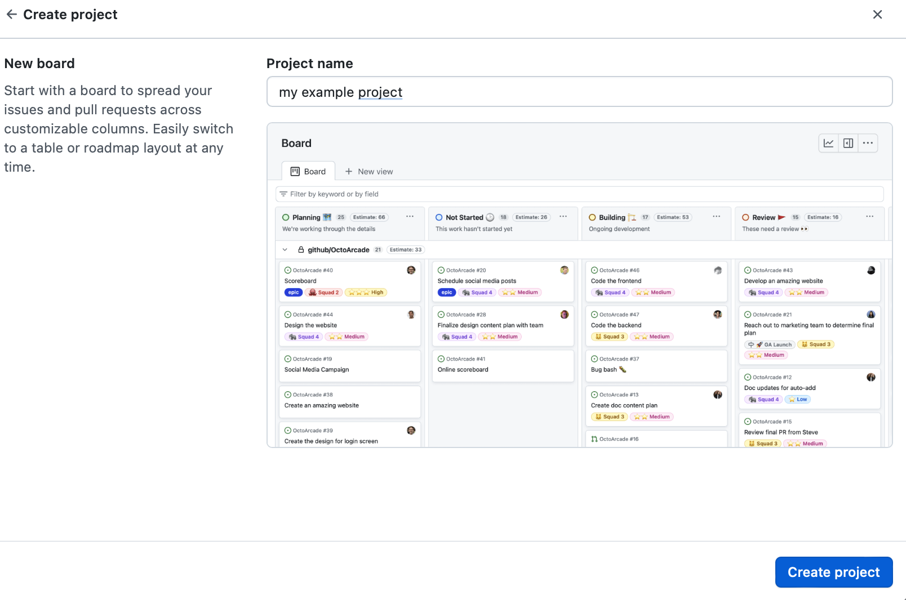

## 3. Dem Team Zugriff geben

1. Klickt oben rechts auf dem Board auf die drei Punkte und geht zu „Settings“ (Einstellungen).
   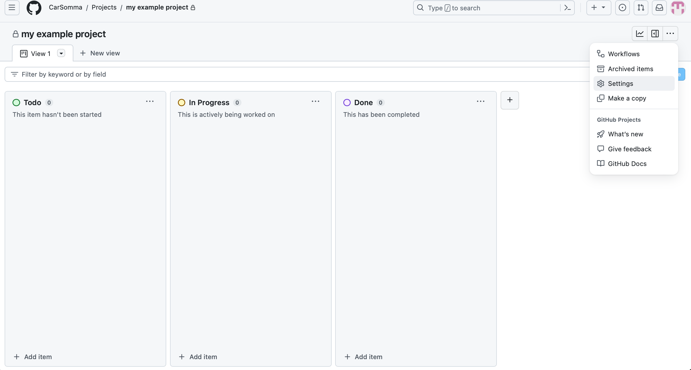

2. Klickt auf „Manage access“ (Zugriff verwalten). Fügt eure Teammitglieder hinzu, indem ihr nach ihrem GitHub-Namen sucht. Ändert ihre Rolle von „Write“ (Schreiben) auf **„Admin“** und klickt auf den blauen Knopf „Invite“ (Einladen). Wiederholt das für alle Teammitglieder.
   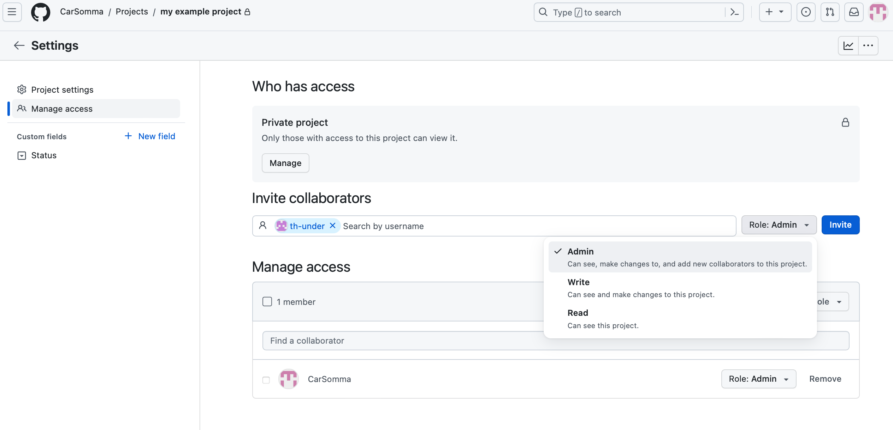

## 4. Aufgaben als Issues hinzufügen

1. Geht zurück zum Kanban-Board und fügt unten Aufgaben (**action items**) mit passenden Namen hinzu, zum Beispiel „load data“ (Daten laden) oder „get statistics“ (Statistiken berechnen).
   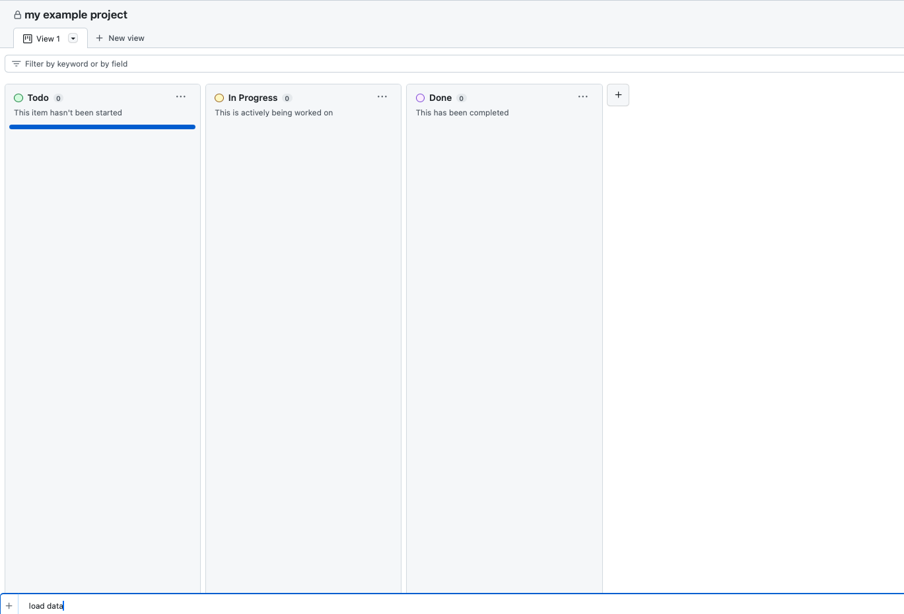

2. Wandelt eine Aufgabe in ein **Issue** um, indem ihr auf die drei Punkte an dieser Aufgabe klickt.
   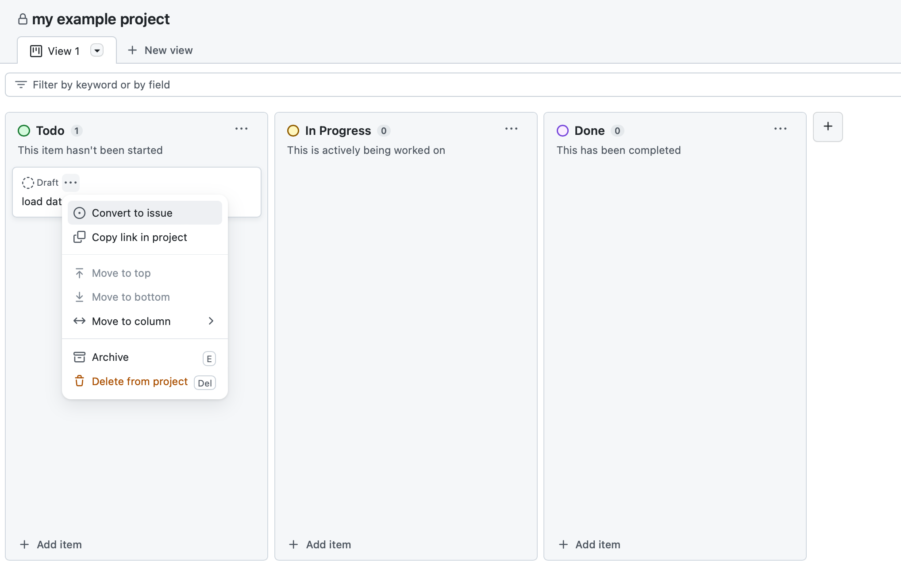

3. Wählt das Repository aus, das ihr erstellt habt, damit das Issue dort hinzugefügt wird (zum Beispiel „my-project-name“).
   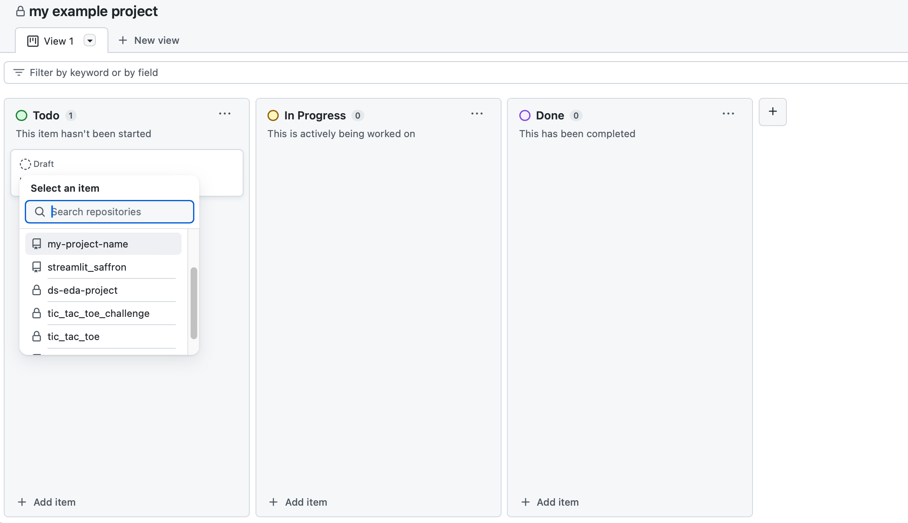

## 5. Meilensteine einrichten

1. Geht in eurem Projekt-Repository zu „Issues“ und dann zu „Milestones“.
   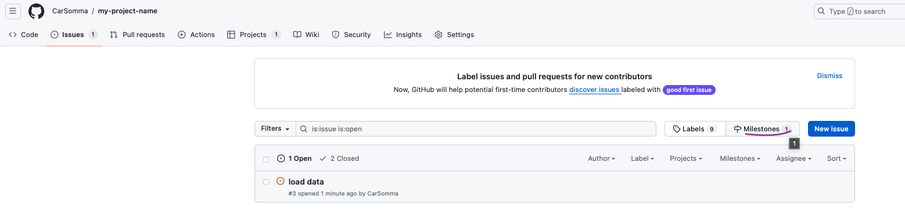

2. Klickt auf „New milestone“ (neuer Meilenstein).

3. Gebt dem Meilenstein ein Fälligkeitsdatum (**due date**) und eine Beschreibung, nach dem Beispiel der Coaches. Die Beschreibung sollte enthalten:

   A) Was erledigt werden muss, damit der Meilenstein fertig ist.

   B) Die **Definition of Done**: wie euer Ergebnis aussieht, wenn der Meilenstein fertig ist (achtet auf das vorgegebene Format).
   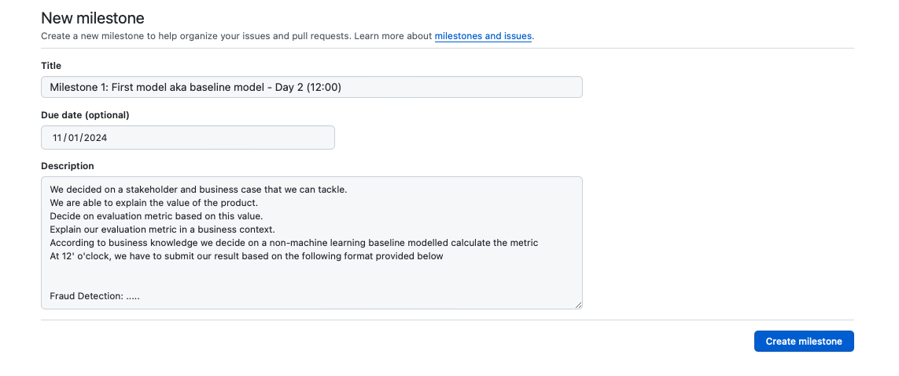

## 6. Issues mit Meilensteinen und Personen verknüpfen

1. Geht zu „Issues“.

2. Ordnet die Issues den Meilensteinen zu.
   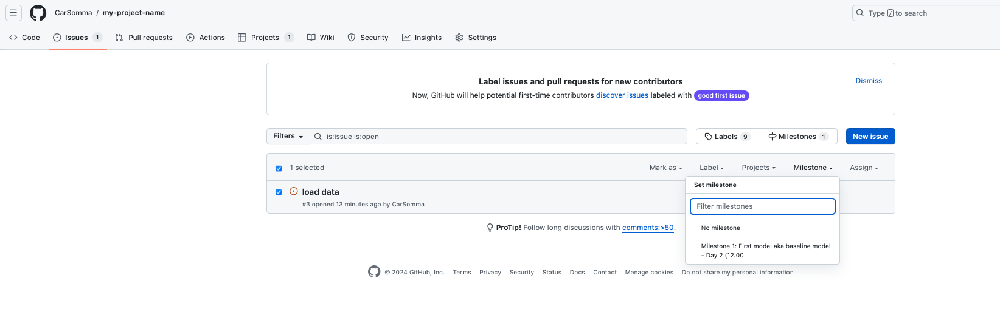

3. Gebt jedem Issue Zuständige (**assignees**), also die Personen, die an der Aufgabe arbeiten.
   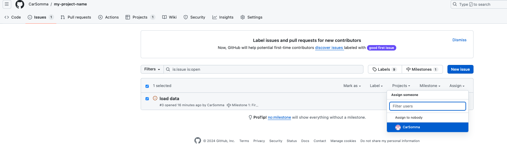

## Optional: Workflows hinzufügen

Workflows (automatische Abläufe) können helfen, das Kanban-Board automatisch auf dem neuesten Stand zu halten.

1. Wählt das Projekt aus, das ihr in den Schritten oben erstellt habt.
2. Klickt ganz rechts auf dem Board auf die drei Punkte.
3. Wählt „Workflows“ als erste Option.
4. Aktiviert die, die ihr für euer Projekt nützlich findet.
5. Geht zurück zu eurem Projekt-Repository.
