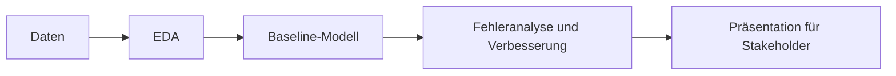

# Vorlage für das Machine-Learning-Projekt

*Deutsche Version von `README.md`.*

Ein Startpunkt für euer Machine-Learning-Teamprojekt. Das Repository enthält ein Beispiel-Notebook, das ein einfaches Modell mit minimaler Bereinigung und Feature-Auswahl trainiert. Nutzt es als Gerüst und baut dann euer eigenes Projekt darauf auf.

Das Beispiel nutzt den [Datensatz zur Kaffeequalität](https://github.com/jldbc/coffee-quality-database).

## Lernziele

Am Ende dieses Repositorys solltet ihr:

- als Team an einem Data-Science-Projekt arbeiten und die Arbeit über den ganzen Data-Science-Lebenszyklus aufteilen können.
- ein Geschäftsproblem als Machine-Learning-Aufgabe formulieren und eine Metrik wählen können, die zum gewünschten Nutzen passt.
- eine Baseline bauen und dann mit Fehleranalyse und mindestens drei Algorithmen verbessern können (inklusive Kreuzvalidierung und Hyperparameter-Tuning).
- eure Ergebnisse und Empfehlungen in einer kurzen Präsentation einem Publikum ohne Technikwissen vermitteln können.

## Lernpfad

Euer Projekt folgt dem Data-Science-Lebenszyklus:



Beginnt mit der Aufgabe, richtet dann euer Board ein und nutzt das Beispiel-Notebook als Vorlage:

| Datei / Ordner | Beschreibung |
|---|---|
| [**Aufgabe**](01_assignment_DE.md) | Die Projektbeschreibung: Zeitplan, Meilensteine, Projektoptionen, Abgabe und worauf ihr achten solltet. |
| [**Kanban-Board**](02_kanban_board_DE.md) | Schritt-für-Schritt-Anleitung für ein Projekt-Board auf GitHub, um eure Arbeit zu planen und zu verfolgen. |
| [**EDA und Modellierung**](03_eda-and-modeling_DE.ipynb) | Durchgerechnetes Beispiel: Features auswählen, minimal bereinigen und ein einfaches Modell trainieren. |

### Weitere Ordner und Dateien

| Datei / Ordner | Beschreibung |
|---|---|
| [**Data**](data/) | Hier kommen eure Datensätze hin. |
| [**Models**](models/) | Hier werden trainierte Modelle gespeichert. |
| [**Assets**](assets/) | Screenshots für die Kanban-Anleitung. |
| [**pyproject.toml**](pyproject.toml) | Projekt-Einstellungen und benötigte Pakete. |
| [**uv.lock**](uv.lock) | Datei, die die genauen Paketversionen festschreibt. |

## Einrichtung (Setup)

Verwendet [uv](https://docs.astral.sh/uv/getting-started/installation/) 0.13.5 oder neuer und Python 3.13.17 oder ein neueres 3.13-Update, wie in [`.python-version`](.python-version) festgelegt.

> [!NOTE]
> In diesen Schritten ist Text in spitzen Klammern wie `<repo-name>` ein **Platzhalter**. Ersetzt ihn **mitsamt** den Klammern `< >` durch euren eigenen Wert. Zum Beispiel wird aus `cd <repo-name>` dann `cd my-ml-project`.

### 1. Das Repository aus der Vorlage erstellen

Klickt auf GitHub auf **Use this template**.

Beim Erstellen des Repositorys:

- Legt euch selbst als **Owner** (Besitzer) fest
- Wählt einen Namen für das Repository
- Schaltet **Include all branches** aus
- Klickt auf **Create repository**

> [!IMPORTANT]
> Wenn ihr zu zweit oder in Gruppen arbeitet, macht diesen Schritt nur **eine Person**.

---

### 2. Mitarbeitende hinzufügen (nur bei Paaren/Gruppen)

Wenn ihr mit anderen zusammenarbeitet:

1. Öffnet das Repository auf GitHub
2. Geht zu **Settings → Collaborators**
3. Fügt eure Teammitglieder als **Collaborators** hinzu
4. Teilt den Link zum Repository mit eurem Team

Die Teammitglieder sollten die Einladung annehmen, bevor es weitergeht.

---

### 3. Das Repository klonen

Kopiert die SSH-Adresse über den Knopf **Code** auf GitHub und führt dann aus:

```bash
git clone <kopierte-ssh-adresse>
```

Die kopierte SSH-Adresse sieht so aus: `git@github.com:<dein-benutzername>/<repo-name>.git`.

---

### 4. In den Projektordner wechseln und Pakete installieren

Damit werden alle benötigten Pakete installiert und eine virtuelle Umgebung im Ordner `.venv/` angelegt.

```bash
cd <repo-name>
uv sync
```

> [!TIP]
> Das ist euer eigenes Projekt, darum fügt ihr unterwegs Bibliotheken hinzu. Installiert ein neues Paket mit `uv add <paket>` (zum Beispiel `uv add xgboost`). Das aktualisiert `pyproject.toml` und `uv.lock` für das ganze Team.

---

### 5. Das Notebook öffnen

> [!NOTE]
> Öffnet VS Code unbedingt im Hauptordner des Projekts. Dann erkennt es die von `uv sync` angelegte Umgebung automatisch.

VS Code im Hauptordner des Projekts starten:

```bash
code .
```

Dann `03_eda-and-modeling.ipynb` öffnen und als Kernel die Python-Umgebung auswählen, die `uv sync` angelegt hat.

## Merge-Konflikte in Notebooks lösen

Wenn man im Team arbeitet, können `.ipynb`-Dateien unübersichtliche **Merge-Konflikte** verursachen (wenn zwei Leute dieselbe Datei geändert haben), weil sie intern aus JSON bestehen. Das Werkzeug `nbdime` macht das einfacher, und `uvx` startet es, ohne es zu euren Projektpaketen hinzuzufügen.

Die Git-Integration einmal einschalten:

```bash
uvx nbdime config-git --enable
```

Wenn ein Konflikt auftritt, das Werkzeug zum Zusammenführen öffnen:

```bash
uvx nbdime mergetool
```

Es öffnet sich eine Weboberfläche, die beide Versionen des Notebooks nebeneinander zeigt. Wählt aus, was ihr behalten wollt, speichert, schließt das Werkzeug und führt dann aus:

```bash
git add your_notebook.ipynb
git commit -m "Resolve notebook conflict"
```

> [!TIP]
> Bei Notebooks ist es eine gute Idee, vor dem Commit die Ausgaben zu löschen, damit es seltener Konflikte gibt. In VS Code geht das über die Befehlspalette (**Strg + Umschalt + P**): `Notebook: Clear All Outputs`.

## Quellen & Weiterlesen

- [**scikit-learn Documentation**](https://scikit-learn.org/stable/): die Bibliothek für die Modellierung, mit Anleitungen und Beispielen.
- [**Choosing the Right Estimator**](https://scikit-learn.org/stable/machine_learning_map.html): eine Übersichtskarte, um je nach Problem und Daten ein Modell auszuwählen.
- [**PEP 8 Style Guide for Python Code**](https://peps.python.org/pep-0008/): der Stil, dem euer Notebook folgen soll.
- [**Jupyter Notebooks in VS Code**](https://code.visualstudio.com/docs/datascience/jupyter-notebooks): wie man Notebooks in VS Code ausführt und einen Kernel wählt.
- [**uv Documentation**](https://docs.astral.sh/uv/): der Paketmanager, der Python und die Pakete für dieses Repo verwaltet.
- [**Zindi Competitions**](https://zindi.africa/competitions): echte Wettbewerbe, von denen einige als Projektoptionen in der Aufgabe stehen.
